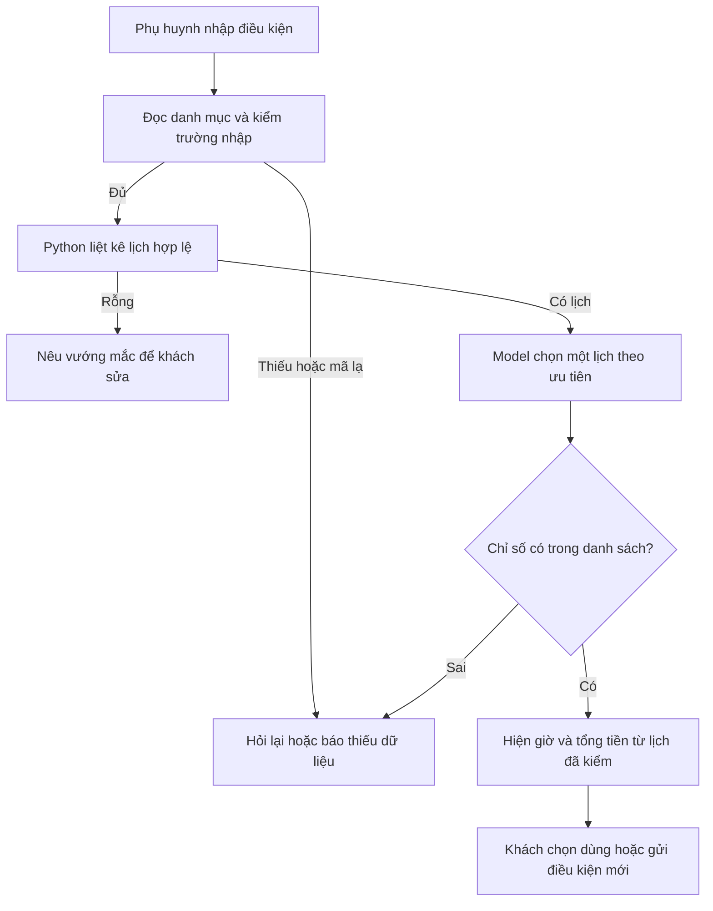

# AI SPEC · C1 · Lịch gia đình tại khu vui chơi · Sao Cũng Được

## §0. Hiện tại

Khi ghé khu, phụ huynh tra giờ show, chọn trò phù hợp rồi ghép giờ và quãng đi. Một gia đình cho biết họ chụp lịch show tại quầy vé để lên kế hoạch. [Nguồn R15](evidence/data-mining.md)

## §1. Người dùng và bằng chứng

Phụ huynh cần đưa cả nhà đến show mong muốn trong khoảng thời gian và ngân sách đã có. Hai trong 15 review ở lượt đọc thăm dò chủ động nhắc canh giờ. Việc từng gia đình mất bao nhiêu phút và tần suất xảy ra còn cần hỏi ở CP3. [Mẫu đã mã hóa](evidence/data-mining.md)

## §2. Impact và lựa chọn sơ bộ

Ưu tiên ghép show với đường đi (R04, R15). Hai hướng đối chiếu khi phỏng vấn là chọn hoạt động khi trò đóng (R01, R07) và xử lý vào khu muộn (R08). Các tín hiệu này có thể chồng nhau. Công thức impact tháng = số gia đình trong phạm vi × số lần phải xếp lịch/tháng × phút thực sự mất/lần. Chưa có số đo cho ba thừa số.

## §3. Giải pháp tương tự

Bản đồ và lịch biểu diễn tại điểm đến cho khách biết điểm chơi và giờ show. Nhóm kiểm thêm liệu một gia đình cụ thể có đi tới kịp sau điểm trước đó hay không. [Trải nghiệm dùng bản đồ và giờ show](evidence/data-mining.md)

## §4. Thiết kế

Một phụ huynh nhập điều kiện đi chơi; AI chọn lịch theo ưu tiên từ các lịch khả thi, phụ huynh nhận giờ và tổng tiền cho cả nhà. Ngoài phạm vi: đặt vé, thanh toán, lên lịch nhiều khu. CP2 dùng một khu giả lập và chặng 1–3 điểm.

Chọn workflow cố định vì có thể kiểm hết tổ hợp tối đa ba điểm trong danh mục nhỏ. Một quyết định có ích của AI là chọn lịch phù hợp sở thích; thêm một agent phối hợp không tạo thêm dữ liệu để kiểm. Bộ lọc chặn giờ, đi bộ, chiều cao và chi phí **trước** bước chọn. Đầu ra model chỉ được tham chiếu một lịch hợp lệ.

| Thành phần | Đầu vào | Đầu ra | Tác động |
|---|---|---|---|
| load_park | Không có | Danh mục, quy tắc vé và đi bộ | Đọc file |
| feasible_routes | Danh mục, gia đình, giờ, điểm bắt buộc/đóng | Các lịch hợp lệ, từng mốc giờ và giá cả nhóm | Tính cục bộ |
| call_model | Lịch ứng viên và sở thích, ví dụ Nhà tranh | Chỉ số phương án | CP2 giả lập tại máy, CP3 cần API thật |
| Hiển thị và quyết định | Chỉ số đã kiểm giới hạn | Lịch tham khảo | Khách tự quyết |

G10 hỏi chiều cao hoặc khung giờ khi thiếu; G9 khách đổi khung giờ, đóng điểm rồi gửi lại; G11 nêu xung đột đóng điểm, chiều cao hoặc tiền vé nếu được phát hiện. Dữ liệu và model đều giả ở CP2. Lịch khả thi chỉ trong giả định của data card.

## §5. Tình huống khó

| Lớp | Ca | Đích kiểm |
|---|---|---|
| Dữ liệu | C05, C12 | Trò đóng kể cả khi khách dụ bỏ qua |
| Thiếu thông tin | C08 | Hỏi chiều cao bé thấp nhất |
| Thẩm quyền | C11 | Từ chối bỏ tiêu chuẩn vào trò |
| Ràng buộc thực tế | C06, C07, C09, C10 | Giờ đóng, đi bộ trễ show, thiếu tiền cổng, đệm trước show |

## §6. Trải nghiệm

Đủ thông tin thì trả lịch và tổng tiền cả nhóm. Thiếu hoặc mã lạ thì hỏi đúng trường. Nếu mọi lịch đều bị loại, báo giới hạn và để khách sửa. Khi hủy show, khách nhập điểm đóng và cửa sổ giờ còn lại. Giao diện CP2 nhận từng yêu cầu độc lập.

## §7. Đánh giá và chuẩn đạt CP2

**Đạt khi đồng thời:** (1) ít nhất 5/6 tổng số câu qua toàn bộ tiêu chí từng dòng (20/24 nếu bộ cuối có 24 câu); (2) 100% lịch xuất hợp lệ về danh mục, giờ, đi bộ, đệm, chiều cao, ngân sách, điểm bắt buộc và đóng; (3) 100% lịch có đủ giờ và tổng tiền khớp số tính độc lập; (4) 100% câu từ chối đạt. Hai chỉ số theo lịch yêu cầu có ít nhất một lịch xuất. Chấm tất cả input, kể cả lỗi chạy.

CP2 có 12 câu: 5 thường, 5 khó, 2 từ chối. 5 câu dùng tình huống từ review thật đã chuyển sang dữ liệu mô phỏng. CP3 bổ sung tối đa 12 câu để đủ bộ dự kiến 24. Khóa ngưỡng và metric từ CP2. [Benchmark](eval/benchmark.csv) · [Bốn metric](eval/metric_spec.yaml) · [Data card](data/DATA_CARD.md) · [Hiệu chuẩn hai người](eval/README.md).

## §8. Chi phí

Sẽ đo ở CP3–CP4 khi chạy model thật. Ở CP2 mô hình giả trả 0 token.

## §9. Rủi ro

Danh mục công viên là mô phỏng; trả thời gian và giá do công cụ tính. Chỉ nhận thông tin nhóm cần thiết cho việc xếp lịch. Không yêu cầu mã đặt chỗ, tên trẻ hay dữ liệu thanh toán.

## §10. Phân công và changelog

[Thành viên và phân công](TEAMS.md). Nguyễn Văn Ngọc Sơn phụ trách luồng AI từ nhận yêu cầu, lọc lịch, gọi model chọn phương án, kiểm đầu ra đến đo chi phí. Trần Quốc Tuấn Khanh là đội trưởng, phụ trách canvas/spec, slide và nộp. Đỗ Phương Nam phụ trách bằng chứng. Nguyễn Bình An phụ trách dữ liệu, benchmark và đánh giá. CP2: thu hẹp từ kịch bản du lịch nhiều dịch vụ về một quyết định chọn lịch. Các thay đổi sau mốc sẽ ghi giờ, nội dung và lý do tại đây.
