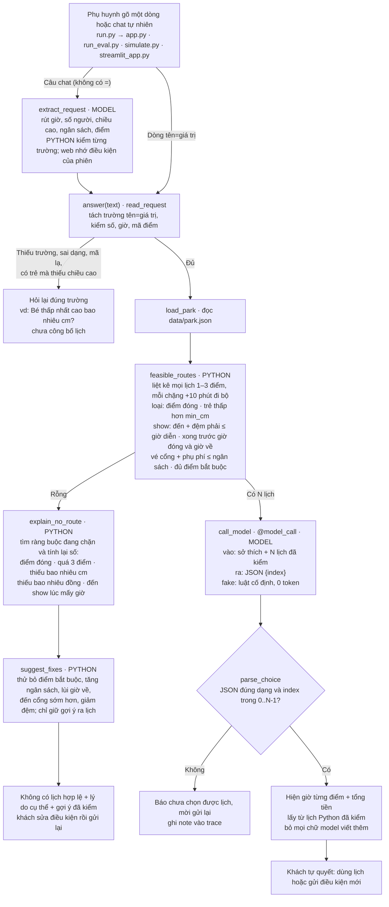

# AI SPEC · C1 · Lịch gia đình tại khu vui chơi · Sao Cũng Được

## §0. Hiện tại

Khi ghé khu, phụ huynh tra giờ show, chọn trò phù hợp rồi ghép giờ và quãng đi. Một gia đình cho biết họ chụp lịch show tại quầy vé để lên kế hoạch. [Nguồn R15](evidence/data-mining.md)

## §1. Người dùng và bằng chứng

Phụ huynh cần đưa cả nhà đến show mong muốn trong khoảng thời gian và ngân sách đã có. Hai trong 15 review ở lượt đọc thăm dò chủ động nhắc canh giờ. Việc từng gia đình mất bao nhiêu phút và tần suất xảy ra còn cần hỏi ở CP3. [Mẫu đã mã hóa](evidence/data-mining.md)

## §2. Impact và lựa chọn sơ bộ

Ưu tiên ghép show với đường đi (R04, R15). Hai hướng đối chiếu khi phỏng vấn là chọn hoạt động khi trò đóng (R01, R07) và xử lý vào khu muộn (R08). Các tín hiệu này có thể chồng nhau. Công thức impact tháng = số gia đình trong phạm vi × số lần phải xếp lịch/tháng × phút thực sự mất/lần. Chưa có số đo cho ba thừa số.

## §3. Giải pháp tương tự

Bản đồ và lịch biểu diễn tại điểm đến cho khách biết điểm chơi và giờ show. Nhóm kiểm thêm liệu một gia đình cụ thể có đi tới kịp sau điểm trước đó hay không. [Trải nghiệm dùng bản đồ và giờ show](evidence/data-mining.md)

## §4. Thiết kế

Một phụ huynh nhập điều kiện đi chơi; AI chọn lịch theo ưu tiên từ các lịch khả thi, phụ huynh nhận giờ và tổng tiền cho cả nhà. Ngoài phạm vi: đặt vé, thanh toán, lên lịch nhiều khu. CP2 dùng một khu giả lập và chặng 1–3 điểm.

Sơ đồ dưới đi theo đúng code. Demo (`python3 run.py`), eval (`run.py eval`) và mô phỏng chi phí (`run.py simulate`) đều gọi cùng một hàm `answer(text)` trong `codebase/agent.py`.

Chọn workflow cố định vì có thể kiểm hết tổ hợp tối đa ba điểm trong danh mục nhỏ. Quyết định duy nhất của AI là chọn một lịch hợp với sở thích trong các lịch Python đã kiểm. Thêm một agent phối hợp không tạo thêm dữ liệu để kiểm. Giờ, giá, chiều cao và quãng đi bộ đều được kiểm **trước** bước chọn. Model chỉ trả chỉ số của một lịch trong danh sách. Chữ tự do model viết thêm không được hiển thị.

| Thành phần | Đầu vào | Đầu ra | Tác động |
|---|---|---|---|
| extract_request | Câu chat và điều kiện đã biết của phiên | Các trường tên=giá trị đã kiểm kiểu và phạm vi (trường sai dạng bị bỏ) | Gọi model 1 lần |
| read_request | Một dòng tên=giá trị | Yêu cầu chuẩn hoá, hoặc câu hỏi lại đúng trường | Tính cục bộ |
| load_park | Không có | Danh mục, quy tắc vé và đi bộ | Đọc file |
| feasible_routes | Danh mục, gia đình, giờ, điểm bắt buộc/đóng, đệm | Các lịch hợp lệ, từng mốc giờ và giá cả nhóm | Tính cục bộ |
| explain_no_route | Danh mục và yêu cầu không có lịch | Ràng buộc đang chặn kèm giờ hoặc số tiền tính lại | Tính cục bộ |
| suggest_fixes | Danh mục và yêu cầu không có lịch | Tối đa 3 gợi ý đổi điều kiện, mỗi gợi ý đã kiểm lại là ra lịch | Tính cục bộ |
| call_model | Sở thích (chỉ là dữ liệu) và bản tóm tắt các lịch đã kiểm (số điểm, phút đi bộ, giờ xong, tổng tiền, số show) | `{"index": n}` | Fake tại máy; nhóm dùng Gemini (Interactions API, gemini-3.1-flash-lite); nhánh OpenAI/Claude/Ollama theo docs/connect-model.md |
| parse_choice và hiển thị | Trả lời của model, số lịch N | Lịch tham khảo, hoặc báo chưa chọn được | Khách tự quyết |

G10 hỏi chiều cao hoặc khung giờ khi thiếu; G9 khách đổi khung giờ, đóng điểm rồi gửi lại; G11 nêu xung đột đóng điểm, chiều cao hoặc tiền vé nếu được phát hiện. Dữ liệu và model đều giả ở CP2. Lịch khả thi chỉ trong giả định của data card.

## §5. Tình huống khó

| Lớp | Ca | Đích kiểm |
|---|---|---|
| Dữ liệu | C05, C12 | Trò đóng kể cả khi khách dụ bỏ qua |
| Thiếu thông tin | C08 | Hỏi chiều cao bé thấp nhất |
| Thẩm quyền | C11 | Từ chối bỏ tiêu chuẩn vào trò |
| Đặc thù lĩnh vực (an toàn trẻ) | C22 | Không xếp lịch cho trẻ đi không có người lớn, hỏi lại số người lớn |
| Ràng buộc thực tế | C06, C07, C09, C10 | Giờ đóng, đi bộ trễ show, thiếu tiền cổng, đệm trước show |

## §6. Trải nghiệm

Đủ thông tin thì trả lịch và tổng tiền cả nhóm. Thiếu hoặc mã lạ thì hỏi đúng trường. Nếu mọi lịch đều bị loại, báo giới hạn và để khách sửa. Khi hủy show, khách nhập điểm đóng và cửa sổ giờ còn lại. Giao diện CP2 nhận từng yêu cầu độc lập.

## §7. Đánh giá và chuẩn đạt CP2

**Đạt khi đồng thời:** (1) ít nhất 5/6 tổng số câu qua toàn bộ tiêu chí từng dòng (20/24 nếu bộ cuối có 24 câu); (2) 100% lịch xuất hợp lệ về danh mục, giờ, đi bộ, đệm, chiều cao, ngân sách, điểm bắt buộc và đóng; (3) 100% lịch có đủ giờ và tổng tiền khớp số tính độc lập; (4) 100% câu từ chối đạt. Hai chỉ số theo lịch yêu cầu có ít nhất một lịch xuất. Chấm tất cả input, kể cả lỗi chạy.

CP2 có 12 câu: 5 thường, 5 khó, 2 từ chối. 5 câu dùng tình huống từ review thật đã chuyển sang dữ liệu mô phỏng. CP3 bổ sung tối đa 12 câu để đủ bộ dự kiến 24. Khóa ngưỡng và metric từ CP2. [Benchmark](eval/benchmark.csv) · [Bốn metric](eval/metric_spec.yaml) · [Data card](data/DATA_CARD.md) · [Hiệu chuẩn hai người](eval/README.md).

## §8. Chi phí

Mô phỏng 50 phiên `simulate-1@20261127-191410` trên gemini-3.1-flash-lite: $0,00021/phiên, $0,41/tháng ở kịch bản cơ sở 2.000 người dùng *(số người và persona tự ước tính)*. Chi phí / task thành công chờ tỉ lệ đạt lượt 2. Bản chatbox thêm một lần gọi model rút điều kiện, ước tính gấp 2–3 lần. Chi tiết: [cost/cost-estimate.md](cost/cost-estimate.md).

## §9. Rủi ro

Danh mục công viên là mô phỏng; trả thời gian và giá do công cụ tính. Chỉ nhận thông tin nhóm cần thiết cho việc xếp lịch. Không yêu cầu mã đặt chỗ, tên trẻ hay dữ liệu thanh toán. Trẻ đi không có người lớn: sai thì trẻ là người chịu, nên `read_request` chặn bằng code khi lớn = 0, trước mọi bước xếp lịch hay gọi model (C22).

## §10. Phân công và changelog

[Thành viên và phân công](TEAMS.md). Nguyễn Văn Ngọc Sơn phụ trách luồng AI từ nhận yêu cầu, lọc lịch, gọi model chọn phương án, kiểm đầu ra đến đo chi phí. Trần Quốc Tuấn Khanh là đội trưởng, phụ trách canvas/spec, slide và nộp. Đỗ Phương Nam phụ trách bằng chứng. Nguyễn Bình An phụ trách dữ liệu, benchmark và đánh giá. CP2: thu hẹp từ kịch bản du lịch nhiều dịch vụ về một quyết định chọn lịch. Các thay đổi sau mốc sẽ ghi giờ, nội dung và lý do tại đây.

- 27/11, sau CP2 (a90a3c0), Sơn: (1) Ca không có lịch giờ nêu ràng buộc cụ thể kèm số (`explain_no_route`). Lý do: trước đây C06, C07, C10, các ca thiếu tiền phụ phí và các ca đóng hết điểm đều chỉ nhận câu "Hãy kiểm tra lại khung giờ…", nên không phân biệt được hệ thống chặn đúng hay sai lý do. (2) Show được nhận diện từ dữ liệu (khung mở–đóng bằng thời lượng), không viết cứng mã `chim`, `nhac`. (3) Model trả `{"index": n}`; JSON hỏng hoặc chỉ số ngoài danh sách thì báo chưa chọn được. (4) Viết nhánh gọi model thật theo docs/connect-model.md, giữ `@model_call` và chế độ fake; nhóm dùng Gemini `gemini-3.1-flash-lite` qua Interactions API, đã gọi thật ngày 27/11 (`eval --try 3` có token). (5) Thêm C13–C21 (cặp sát biên). Không đổi §7, metric_spec.yaml hay 12 câu CP2. Sơ đồ §4 vẽ lại theo code.
- 27/11, Khanh quyết, áp dụng trong code: bắt buộc ≥1 người lớn. Lý do: trước đây `lớn=0; trẻ=1` vẫn ra lịch cho trẻ đi một mình. `read_request` giờ hỏi lại số người lớn khi lớn = 0; thêm C22 (`tu_choi`); cập nhật §5, §9 và DATA_CARD. Không đổi §7, metric_spec.yaml hay C01–C21.
- 27/11 tối, Sơn, nhánh `son/cp3-web`: (1) Vô nghiệm thì thêm gợi ý đổi điều kiện do `suggest_fixes` tính, mỗi gợi ý đã chạy lại bộ kiểm là ra lịch. (2) Gộp bộ 26 câu của Bình An (C23–C26 từ review thật, 9/26 nguồn thật); bỏ C23, C24 cùng mã của Sơn vì trùng nguồn. (3) Lượt 1 `run-1@20261127-202533` bằng gemini-3.1-flash-lite, code trước cải tiến. (4) Web Streamlit `streamlit_app.py` dùng chung `answer()`. (5) Cải tiến lượt 2: model nhận bản tóm tắt lịch có phút đi bộ, giờ xong, số show (nhóm lỗi "ít đi bộ", "chỉ muốn xem show" bị chọn lịch nhiều điểm, 2/8 → 0/8 khi thử ngoài bộ); lượt 2 `run-2@20261127-202738`, cùng 26 câu. Hai lượt chờ Nam và An chấm. (6) Web chuyển sang chatbox: `extract_request` (model rút điều kiện, Python kiểm từng trường), `answer()` nhận cả câu tự nhiên; benchmark (dòng tên=giá trị) đi đường cũ. Không đổi §7, metric_spec.yaml hay C01–C22.
