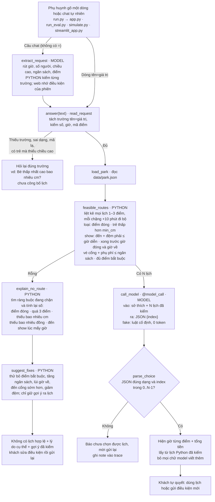

# AI SPEC · C1 · Lịch gia đình tại khu vui chơi · Sao Cũng Được

## §0. Hiện tại

Phụ huynh tự lên kế hoạch và tự xoay khi kế hoạch hỏng. Ba phụ huynh được phỏng vấn dùng ba cách khác nhau để biết giờ show, giờ đóng trò: chụp bảng thông tin ở cổng (P1), hỏi miệng bảo vệ / nhân viên (P2), app chính thức của khu có thời gian chờ thực tế (P3). Không ai dùng công cụ xếp lịch theo điều kiện riêng của gia đình (tuổi, chiều cao của con, giờ phải về). Review công khai cũng có khách khuyên chụp bảng giờ show (R15). [Phỏng vấn](evidence/summary.md) · [Review](evidence/data-mining.md)

## §1. Người dùng và bằng chứng

Người dùng: phụ huynh tự lên kế hoạch khi đưa trẻ dưới 12 tuổi đi một khu vui chơi trong một buổi. Nguồn đạt ngưỡng: **phỏng vấn 3 phụ huynh ngoài nhóm** (27/11/2026, 3 khu khác nhau, lần đi 2–4 tuần trước).

- **2/3** gặp lỗi giờ / điều kiện và nói được số phút xếp lại (P1 thiếu chiều cao 2 cm; P2 lỡ show xiếc vì giờ hỏi miệng sai + trò bảo trì) → đạt ngưỡng chốt trước ở [hypothesis.md](evidence/hypothesis.md).
- **3/3** có trò / show định chơi mà không chơi được, mỗi người một lý do (chiều cao · bảo trì · hàng chờ). **3/3** đổi kế hoạch giữa ngày.
- Riêng lỡ show vì sai giờ: **1/3**. Xếp hàng đông: **2/3**.
- Review: 2/15 (13,3% mẫu thăm dò) kể hoặc khuyên canh giờ show (R04, R15).
- Khảo sát kiểm lại (28/11, group cộng đồng dân cư, 20 phản hồi, **10 qua sàng lọc**, chưa đủ ngưỡng ≥20): lỗi giờ / điều kiện chỉ **2/10** → dưới ngưỡng 1/4 chốt trước; đổi kế hoạch vì trở ngại 5/10, lý do lớn nhất là **xếp hàng 3/5**. Mẫu không chỉ phụ huynh ([results.csv](evidence/survey/results.csv)).

*"Lúc đo chiều cao cháu thiếu đúng 2cm không được vào trò tàu lượn làm cháu dỗi cả buổi chiều, thành ra kế hoạch xem nhạc nước buổi tối cũng phải hủy để đi về."* (P1)

**Kết luận:** giả thuyết đúng một phần, đổi trọng tâm từ "canh giờ show" sang "trò định chơi mà không chơi được vì điều kiện". n = 3 là tín hiệu, chưa phải tỉ lệ. Khảo sát (10 người qua sàng lọc) **ngược chiều** ở lỗi giờ (2/10) và **cùng chiều** ở hàng chờ (3/5) → pain hàng chờ lớn hơn lỗi giờ. [Tổng hợp và trích dẫn](evidence/summary.md)

## §2. Impact và lựa chọn sơ bộ

**Công thức impact / tháng** = số gia đình trong phạm vi × số lần đi / tháng × (phút chuẩn bị + phút xếp lại giữa ngày) / lần.

| Thừa số | Số có nguồn | Nguồn |
|---|---|---|
| Số lần đi / năm của một gia đình | 3 · 4 · khoảng 6–7 (trung vị 4 → khoảng 0,33 lần / tháng) | P1–P3 câu 8 |
| Phút chuẩn bị trước khi đi | 15 · 45 · 60 | P1–P3 câu 2 |
| Phút quyết định đổi kế hoạch giữa ngày | 2 · 5 · 10 | P1–P3 câu 4 |
| Lượt khách chuỗi VinWonders năm 2025 | 9,11 triệu lượt (tăng 17%) | Vinpearl công bố KQKD 2025: [Báo Pháp luật VN – Doanh nhân, 30/01/2026](https://doanhnhan.baophapluat.vn/vinpearl-vpl-doanh-thu-nam-2025-vuot-15-500-ty-dong-mang-khach-san-tang-truong-34.html). **Không có số riêng VinWonders Nha Trang** — số là của cả chuỗi |
| Số người mỗi nhóm đi chơi | 4 · 2 · 3 (trung bình 3) | P1–P3, n = 3 |
| Tỉ lệ lượt khách thuộc gia đình có trẻ dưới 12 | 50% *(tự ước tính)*; trần 100% | chưa có nguồn — khảo sát đã phát không có câu lọc đi cùng trẻ nên không kiểm được |
| → Số lượt đi của gia đình có trẻ (= số gia đình × số lần đi) | 9,11 triệu ÷ 3 ≈ 3,04 triệu nhóm-lượt / năm (trần); × 50% ≈ 1,52 triệu / năm ≈ 126.500 / tháng | tính từ 3 dòng trên |

Với một gia đình (trung vị): khoảng 0,33 lần / tháng × (45 + 5) phút ≈ 17 phút / tháng *(tính từ 3 phỏng vấn, chưa phải tỉ lệ chung)*. Khảo sát cho phút chuẩn bị thấp hơn (8/10 ≤15 phút), nên 45 phút có thể làm impact cao.

Quy mô chuỗi VinWonders: khoảng 126.500 nhóm-lượt / tháng × 50 phút ≈ 6,3 triệu phút ≈ **105.000 giờ / tháng** *(dùng tỉ lệ 50% tự ước tính; trần nếu mọi lượt khách là gia đình có trẻ: ≈ 211.000 giờ / tháng)*. Đây là phút chuẩn bị + xếp lại mà các gia đình đang bỏ ra, không phải phút bản chạy thử chắc chắn tiết kiệm được; số người mỗi nhóm chỉ từ 3 phỏng vấn. Impact không chỉ là phút: P1 và P2 kể con dỗi, cả nhà bỏ show buổi tối hoặc về sớm — mất một phần buổi đi đã trả tiền vé.

**So ≥3 hướng**

| Hướng | Bằng chứng | Bản chạy thử làm được? | Chọn |
|---|---|---|---|
| A. Xếp lịch thoả điều kiện trò: chiều cao, trò đóng / bảo trì, giờ show + đệm, giờ về, ngân sách | 3/3 có trò không chơi được; 2/3 vì chiều cao, bảo trì, lỡ show | Có — ràng buộc cứng kiểm bằng code | **Chọn** |
| B. Báo thời gian chờ thực tế, né hàng đông | 2/3 (P1, P3) | Không — cần dữ liệu hàng chờ real-time của khu, không có ([DATA_CARD](data/DATA_CARD.md)); P3 cho thấy app chính thức đã làm phần này | Không chọn, ghi ở §9 |
| C. Chỉ nhắc giờ show | 1/3 lỡ show; 2/15 review | Có nhưng hẹp — P1 chụp bảng, P3 dùng app đã đủ | Gộp vào A như một ràng buộc |

## §3. Giải pháp tương tự

Bản đồ và lịch biểu diễn tại điểm đến cho khách biết điểm chơi và giờ show. Nhóm kiểm thêm liệu một gia đình cụ thể có đi tới kịp sau điểm trước đó hay không. [Trải nghiệm dùng bản đồ và giờ show](evidence/data-mining.md)

## §4. Thiết kế

Một phụ huynh nhập điều kiện đi chơi; AI chọn lịch theo ưu tiên từ các lịch khả thi, phụ huynh nhận giờ và tổng tiền cho cả nhà. Ngoài phạm vi: đặt vé, thanh toán, lên lịch nhiều khu. CP2 dùng một khu giả lập và chặng 1–3 điểm.

Sơ đồ dưới đi theo đúng code. Demo (`python3 run.py`), eval (`run.py eval`) và mô phỏng chi phí (`run.py simulate`) đều gọi cùng một hàm `answer(text)` trong `codebase/agent.py`.

Chọn workflow cố định vì có thể kiểm hết tổ hợp tối đa ba điểm trong danh mục nhỏ. Quyết định duy nhất của AI là chọn một lịch hợp với sở thích trong các lịch Python đã kiểm. Thêm một agent phối hợp không tạo thêm dữ liệu để kiểm. Giờ, giá, chiều cao và quãng đi bộ đều được kiểm **trước** bước chọn. Model chỉ trả chỉ số của một lịch trong danh sách. Chữ tự do model viết thêm không được hiển thị.

| Thành phần | Đầu vào | Đầu ra | Tác động |
|---|---|---|---|
| extract_request | Câu chat và điều kiện đã biết của phiên | Các trường tên=giá trị đã kiểm kiểu và phạm vi (trường sai dạng bị bỏ) | Gọi model 1 lần |
| read_request | Một dòng tên=giá trị | Yêu cầu chuẩn hoá, hoặc câu hỏi lại đúng trường | Tính cục bộ |
| load_park | Không có | Danh mục, quy tắc vé và đi bộ | Đọc file |
| feasible_routes | Danh mục, gia đình, giờ, điểm bắt buộc/đóng, đệm | Các lịch hợp lệ, từng mốc giờ và giá cả nhóm | Tính cục bộ |
| explain_no_route | Danh mục và yêu cầu không có lịch | Ràng buộc đang chặn kèm giờ hoặc số tiền tính lại | Tính cục bộ |
| suggest_fixes | Danh mục và yêu cầu không có lịch | Tối đa 3 gợi ý đổi điều kiện, mỗi gợi ý đã kiểm lại là ra lịch | Tính cục bộ |
| call_model | Sở thích (chỉ là dữ liệu) và bản tóm tắt các lịch đã kiểm (số điểm, phút đi bộ, giờ xong, tổng tiền, số show) | `{"index": n}` | Fake tại máy; nhóm dùng Gemini (Interactions API, gemini-3.1-flash-lite); nhánh OpenAI/Claude/Ollama theo docs/connect-model.md |
| parse_choice và hiển thị | Trả lời của model, số lịch N | Lịch tham khảo, hoặc báo chưa chọn được | Khách tự quyết |

G10 hỏi chiều cao hoặc khung giờ khi thiếu; G9 khách đổi khung giờ, đóng điểm rồi gửi lại; G11 nêu xung đột đóng điểm, chiều cao hoặc tiền vé nếu được phát hiện. Dữ liệu và model đều giả ở CP2. Lịch khả thi chỉ trong giả định của data card.

## §5. Tình huống khó

| Lớp | Ca | Đích kiểm |
|---|---|---|
| Dữ liệu | C05, C12 | Trò đóng kể cả khi khách dụ bỏ qua |
| Thiếu thông tin | C08 | Hỏi chiều cao bé thấp nhất |
| Thẩm quyền | C11 | Từ chối bỏ tiêu chuẩn vào trò |
| Đặc thù lĩnh vực (an toàn trẻ) | C22 | Không xếp lịch cho trẻ đi không có người lớn, hỏi lại số người lớn |
| Ràng buộc thực tế | C06, C07, C09, C10 | Giờ đóng, đi bộ trễ show, thiếu tiền cổng, đệm trước show |

## §6. Trải nghiệm

Đủ thông tin thì trả lịch và tổng tiền cả nhóm. Thiếu hoặc mã lạ thì hỏi đúng trường. Nếu mọi lịch đều bị loại, báo giới hạn và để khách sửa. Khi hủy show, khách nhập điểm đóng và cửa sổ giờ còn lại. Giao diện CP2 nhận từng yêu cầu độc lập.

## §7. Đánh giá và chuẩn đạt CP2

**Đạt khi đồng thời:** (1) ít nhất 5/6 tổng số câu qua toàn bộ tiêu chí từng dòng (20/24 nếu bộ cuối có 24 câu); (2) 100% lịch xuất hợp lệ về danh mục, giờ, đi bộ, đệm, chiều cao, ngân sách, điểm bắt buộc và đóng; (3) 100% lịch có đủ giờ và tổng tiền khớp số tính độc lập; (4) 100% câu từ chối đạt. Hai chỉ số theo lịch yêu cầu có ít nhất một lịch xuất. Chấm tất cả input, kể cả lỗi chạy.

CP2 có 12 câu: 5 thường, 5 khó, 2 từ chối. 5 câu dùng tình huống từ review thật đã chuyển sang dữ liệu mô phỏng. CP3 bổ sung tối đa 12 câu để đủ bộ dự kiến 24. Khóa ngưỡng và metric từ CP2. [Benchmark](eval/benchmark.csv) · [Bốn metric](eval/metric_spec.yaml) · [Data card](data/DATA_CARD.md) · [Hiệu chuẩn hai người](eval/README.md).

## §8. Chi phí

Mô phỏng 50 phiên `simulate-2@20261128-120240` trên gemini-3.1-flash-lite, tỉ lệ đạt 25/26 từ `run-2@20261127-202738`: $0,00019/phiên, $0,00020/task thành công, $1,18/tháng ở kịch bản cơ sở 6.325 gia đình (5% của ≈126.500 nhóm-lượt gia đình / tháng ở §2; tỉ lệ dùng và persona *(tự ước tính)*); kịch bản cao 12.650 gia đình: $2,37 (gemini-3.8-flash: $13,97). Bản chatbox thêm một lần gọi model rút điều kiện, ước tính gấp 2–3 lần. Chi tiết: [cost/cost-estimate.md](cost/cost-estimate.md).

## §9. Rủi ro

Danh mục công viên là mô phỏng; trả thời gian và giá do công cụ tính. Chỉ nhận thông tin nhóm cần thiết cho việc xếp lịch. Không yêu cầu mã đặt chỗ, tên trẻ hay dữ liệu thanh toán. **Hàng chờ ngoài phạm vi:** 2/3 phụ huynh bỏ trò vì xếp hàng đông (P1, P3) và xếp hàng là lý do đổi kế hoạch lớn nhất ở khảo sát (3/5), nhưng bản chạy thử không có dữ liệu thời gian chờ, nên một lịch hợp lệ vẫn có thể hỏng vì hàng dài. Lịch hiển thị là tham khảo; khách gửi lại khung giờ còn lại và điểm cần bỏ (`đóng=`) để xếp lại. Trẻ đi không có người lớn: sai thì trẻ là người chịu, nên `read_request` chặn bằng code khi lớn = 0, trước mọi bước xếp lịch hay gọi model (C22).

## §10. Phân công và changelog

[Thành viên và phân công](TEAMS.md). Nguyễn Văn Ngọc Sơn phụ trách luồng AI từ nhận yêu cầu, lọc lịch, gọi model chọn phương án, kiểm đầu ra đến đo chi phí. Trần Quốc Tuấn Khanh là đội trưởng, phụ trách canvas/spec, slide và nộp. Đỗ Phương Nam phụ trách bằng chứng. Nguyễn Bình An phụ trách dữ liệu, benchmark và đánh giá. CP2: thu hẹp từ kịch bản du lịch nhiều dịch vụ về một quyết định chọn lịch. Các thay đổi sau mốc sẽ ghi giờ, nội dung và lý do tại đây.

- 27/11, sau CP2 (a90a3c0), Sơn: (1) Ca không có lịch giờ nêu ràng buộc cụ thể kèm số (`explain_no_route`). Lý do: trước đây C06, C07, C10, các ca thiếu tiền phụ phí và các ca đóng hết điểm đều chỉ nhận câu "Hãy kiểm tra lại khung giờ…", nên không phân biệt được hệ thống chặn đúng hay sai lý do. (2) Show được nhận diện từ dữ liệu (khung mở–đóng bằng thời lượng), không viết cứng mã `chim`, `nhac`. (3) Model trả `{"index": n}`; JSON hỏng hoặc chỉ số ngoài danh sách thì báo chưa chọn được. (4) Viết nhánh gọi model thật theo docs/connect-model.md, giữ `@model_call` và chế độ fake; nhóm dùng Gemini `gemini-3.1-flash-lite` qua Interactions API, đã gọi thật ngày 27/11 (`eval --try 3` có token). (5) Thêm C13–C21 (cặp sát biên). Không đổi §7, metric_spec.yaml hay 12 câu CP2. Sơ đồ §4 vẽ lại theo code.
- 27/11, Khanh quyết, áp dụng trong code: bắt buộc ≥1 người lớn. Lý do: trước đây `lớn=0; trẻ=1` vẫn ra lịch cho trẻ đi một mình. `read_request` giờ hỏi lại số người lớn khi lớn = 0; thêm C22 (`tu_choi`); cập nhật §5, §9 và DATA_CARD. Không đổi §7, metric_spec.yaml hay C01–C21.
- 27/11 tối, Sơn, nhánh `son/cp3-web`: (1) Vô nghiệm thì thêm gợi ý đổi điều kiện do `suggest_fixes` tính, mỗi gợi ý đã chạy lại bộ kiểm là ra lịch. (2) Gộp bộ 26 câu của Bình An (C23–C26 từ review thật, 9/26 nguồn thật); bỏ C23, C24 cùng mã của Sơn vì trùng nguồn. (3) Lượt 1 `run-1@20261127-202533` bằng gemini-3.1-flash-lite, code trước cải tiến. (4) Web Streamlit `streamlit_app.py` dùng chung `answer()`. (5) Cải tiến lượt 2: model nhận bản tóm tắt lịch có phút đi bộ, giờ xong, số show (nhóm lỗi "ít đi bộ", "chỉ muốn xem show" bị chọn lịch nhiều điểm, 2/8 → 0/8 khi thử ngoài bộ); lượt 2 `run-2@20261127-202738`, cùng 26 câu. Hai lượt chờ Nam và An chấm. (6) Web chuyển sang chatbox: `extract_request` (model rút điều kiện, Python kiểm từng trường), `answer()` nhận cả câu tự nhiên; benchmark (dòng tên=giá trị) đi đường cũ. Không đổi §7, metric_spec.yaml hay C01–C22.
- 27/11 tối (sau phỏng vấn P1–P3), Khanh: cập nhật §0, §1, §2, §9 theo [evidence/summary.md](evidence/summary.md). §1 thay số review bằng số phỏng vấn (2/3 đạt ngưỡng, 3/3 có trò không chơi được); §2 điền thừa số impact có nguồn và bảng so 3 hướng; §9 thêm rủi ro hàng chờ ngoài phạm vi. Không đổi §4–§7, metric_spec.yaml hay benchmark.
- 28/11, Khanh: §2 điền quy mô từ số công khai — chuỗi VinWonders 9,11 triệu lượt năm 2025 (Vinpearl, báo 30/01/2026; không có số riêng Nha Trang), chia 3 người/nhóm (P1–P3), tỉ lệ gia đình có trẻ 50% *(tự ước tính)* → ≈105.000 giờ / tháng. Không đổi §4–§7.
- 28/11 trưa, Khanh: (1) Chấm tay xong hai lượt (Bình An, Tuấn Khanh): 25/26 → 25/26, C21 trượt cả hai lượt. (2) §8: mô phỏng `simulate-2@20261128-120240` với tỉ lệ đạt lượt 2 và số người dùng từ §2. (3) §1, §2, §9: thêm kết quả khảo sát (10/20 qua sàng lọc, 2/10 lỗi giờ / điều kiện, xếp hàng 3/5). (4) `eval/README.md` viết lại thành hồ sơ đánh giá CP4. (5) `demo-slides.pdf` 8 trang, kết luận ITERATE. Không đổi §4–§7, metric_spec.yaml hay benchmark.
- 28/11, Khanh: ghi [validation/log.md](validation/log.md) — 3 phụ huynh ngoài nhóm thử bản `main` lúc 10:00 28/11 (Khanh đứng phiên): hơi tiếc 2 · không sao 1. Lỗi mức cao: người thử tưởng gợi ý đã tự xếp lại cả buổi và giữ chỗ / vé. Hệ thống bỏ qua ý "hàng chờ đông". Việc sửa (nhãn "chỉ là gợi ý", cảnh báo chiều cao rõ hơn, hiện phút đi bộ, báo chưa có dữ liệu hàng chờ) chưa làm, ghi ở log và slide 8 (`demo-slides.pdf` xuất lại). Không đổi code, §4–§7 hay benchmark.
